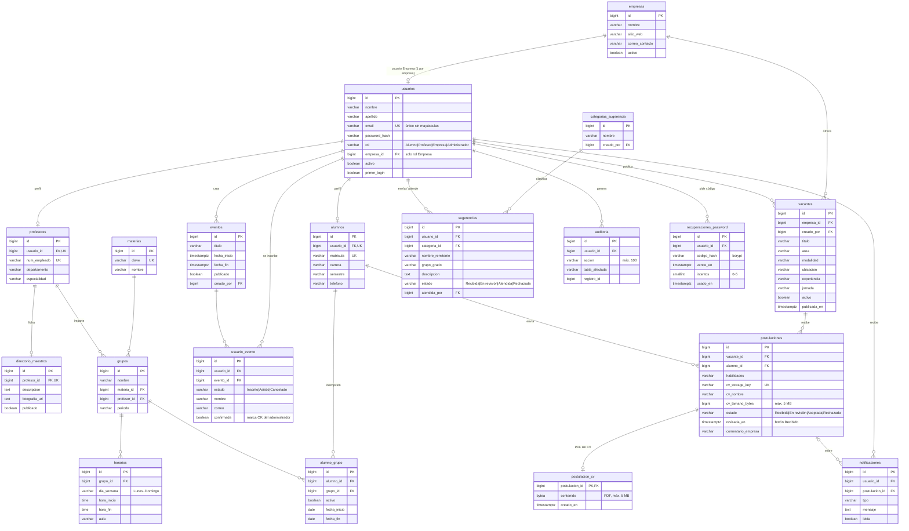

# Esquema de la base de datos SIUT (Neon / PostgreSQL 18)

Generado el 2026-11-08 (actualizado tras la migración del CV y, el 2026-11-12, con `migrations/2026-11-12_seguimiento_postulaciones_eventos.sql`, `migrations/2026-11-12_borrar_playing_with_neon.sql` y `migrations/2026-11-12_recuperaciones_password.sql`) leyendo el catálogo de Neon en modo **solo lectura**. Refleja la base de datos real, no `Models/models.py`.

- 20 tablas en el esquema `public` (19 de la app y `siut_control_admin` de control). La tabla de ejemplo de Neon `playing_with_neon` se borró el 2026-11-12.
- Todos los `id` son `bigint GENERATED ALWAYS AS IDENTITY` (salvo `postulacion_cv`, cuya llave es la de su postulación).
- Cambios de esquema: scripts versionados en `migrations/`.
- Todas las llaves foráneas usan `ON DELETE RESTRICT`.
- Todas las fechas son `timestamptz` con `DEFAULT now()`.

## Diagrama entidad-relación

## Reglas de negocio implementadas en la base de datos

| Regla | Dónde |
|---|---|
| Roles válidos: `Alumno`, `Profesor`, `Empresa`, `Administrador` | CHECK `chk_usuarios_rol` |
| Solo `Empresa` lleva `empresa_id`, y siempre | CHECK `chk_usuario_empresa` |
| Un usuario `Empresa` por empresa | índice único parcial `uq_usuario_empresa` |
| Correo único sin distinguir mayúsculas | índice único `uq_usuarios_email` sobre `lower(email)` |
| `Alumno` ⇒ exactamente 1 perfil en `alumnos` y 0 en `profesores`; `Profesor` al revés; `Empresa`/`Administrador` ⇒ sin perfiles académicos | triggers diferidos `trg_validar_*_perfil` → `validar_un_usuario()` (se valida al hacer COMMIT) |
| Máximo 4 cuentas `Administrador` | trigger `trg_limite_administradores` + tabla `siut_control_admin` |
| Prohibido borrar usuarios: solo se desactivan (`activo = false`) | trigger `trg_impedir_borrado_usuario` |
| Solo `Administrador` (cualquier empresa) o `Empresa` (la suya) pueden crear o reasignar vacantes | trigger `trg_validar_creador_vacante` |
| Catálogos de vacantes (área, modalidad, ubicación, experiencia, jornada) y "ubicación Remoto ⇒ modalidad Remoto" | CHECK `chk_vacante_*` |
| CV: solo `application/pdf`, de 1 byte a 5 MB; una postulación por alumno y vacante. El PDF se guarda en `postulacion_cv` | CHECK `chk_postulacion_pdf`, `chk_cv_tamano`, `chk_postulacion_cv_tamano`; UNIQUE `uq_alumno_vacante` |
| Estados válidos de postulación, sugerencia e inscripción a evento | CHECK `chk_postulacion_estado`, `chk_sugerencia_estado`, `chk_estado_evento` |
| Horarios: día Lunes–Domingo y `hora_fin > hora_inicio` | CHECK `chk_dia_semana`, `chk_horario` |
| Un alumno solo puede tener un grupo activo a la vez | índice único parcial `uq_alumno_un_grupo_activo` |
| Fechas de fin ≥ fechas de inicio (eventos, inscripciones) | CHECK `chk_fechas_evento`, `chk_fechas_inscripcion` |
| Código de recuperación de contraseña: de 0 a 5 intentos | CHECK `chk_recuperaciones_intentos` |

## Detalle por tabla

### `usuarios`

| Columna | Tipo | Nulo | Por defecto |
|---|---|---|---|
| `id` | bigint | no |  |
| `nombre` | varchar(100) | no |  |
| `apellido` | varchar(100) | sí |  |
| `email` | varchar(255) | no |  |
| `password_hash` | varchar(255) | no |  |
| `rol` | varchar(20) | no | `'Alumno'` |
| `empresa_id` | bigint | sí |  |
| `activo` | boolean | no | `true` |
| `primer_login` | boolean | no | `true` |
| `creado_por` | bigint | sí |  |
| `modificado_por` | bigint | sí |  |
| `creado_en` | timestamptz | no | `now()` |
| `modificado_en` | timestamptz | no | `now()` |

**Restricciones e índices:**

- CHECK `chk_usuario_empresa`: `CHECK (((((rol) = 'Empresa') AND (empresa_id IS NOT NULL)) OR (((rol) <> 'Empresa') AND (empresa_id IS NULL))))`
- CHECK `chk_usuarios_rol`: `CHECK (((rol) = ANY ((ARRAY['Alumno', 'Profesor', 'Empresa', 'Administrador']))))`
- FK `usuarios_creado_por_fkey`: `FOREIGN KEY (creado_por) REFERENCES usuarios(id) ON DELETE RESTRICT`
- FK `usuarios_empresa_id_fkey`: `FOREIGN KEY (empresa_id) REFERENCES empresas(id) ON DELETE RESTRICT`
- FK `usuarios_modificado_por_fkey`: `FOREIGN KEY (modificado_por) REFERENCES usuarios(id) ON DELETE RESTRICT`
- PK `usuarios_pkey`: `PRIMARY KEY (id)`
- TRIGGER `trg_validar_usuario_perfil`: `TRIGGER DEFERRABLE INITIALLY DEFERRED`
- ÍNDICE `uq_usuario_empresa`: `btree (empresa_id) WHERE ((rol)::text = 'Empresa'::text)` (único)
- ÍNDICE `uq_usuarios_email`: `btree (lower((email)::text))` (único)

### `empresas`

| Columna | Tipo | Nulo | Por defecto |
|---|---|---|---|
| `id` | bigint | no |  |
| `nombre` | varchar(150) | no |  |
| `descripcion` | text | sí |  |
| `logo_url` | text | sí |  |
| `sitio_web` | varchar(255) | sí |  |
| `correo_contacto` | varchar(150) | sí |  |
| `telefono` | varchar(30) | sí |  |
| `activo` | boolean | no | `true` |
| `creado_en` | timestamptz | no | `now()` |
| `modificado_en` | timestamptz | no | `now()` |

**Restricciones e índices:**

- PK `empresas_pkey`: `PRIMARY KEY (id)`

### `alumnos`

| Columna | Tipo | Nulo | Por defecto |
|---|---|---|---|
| `id` | bigint | no |  |
| `usuario_id` | bigint | no |  |
| `matricula` | varchar(50) | no |  |
| `carrera` | varchar(120) | sí |  |
| `semestre` | varchar(30) | sí |  |
| `telefono` | varchar(30) | sí |  |
| `creado_en` | timestamptz | no | `now()` |
| `modificado_en` | timestamptz | no | `now()` |

**Restricciones e índices:**

- FK `alumnos_usuario_id_fkey`: `FOREIGN KEY (usuario_id) REFERENCES usuarios(id) ON DELETE RESTRICT`
- PK `alumnos_pkey`: `PRIMARY KEY (id)`
- TRIGGER `trg_validar_alumno_perfil`: `TRIGGER DEFERRABLE INITIALLY DEFERRED`
- UNIQUE `alumnos_matricula_key`: `UNIQUE (matricula)`
- UNIQUE `alumnos_usuario_id_key`: `UNIQUE (usuario_id)`

### `profesores`

| Columna | Tipo | Nulo | Por defecto |
|---|---|---|---|
| `id` | bigint | no |  |
| `usuario_id` | bigint | no |  |
| `num_empleado` | varchar(50) | no |  |
| `departamento` | varchar(120) | sí |  |
| `especialidad` | varchar(150) | sí |  |
| `activo` | boolean | no | `true` |
| `creado_en` | timestamptz | no | `now()` |
| `modificado_en` | timestamptz | no | `now()` |

**Restricciones e índices:**

- FK `profesores_usuario_id_fkey`: `FOREIGN KEY (usuario_id) REFERENCES usuarios(id) ON DELETE RESTRICT`
- PK `profesores_pkey`: `PRIMARY KEY (id)`
- TRIGGER `trg_validar_profesor_perfil`: `TRIGGER DEFERRABLE INITIALLY DEFERRED`
- UNIQUE `profesores_num_empleado_key`: `UNIQUE (num_empleado)`
- UNIQUE `profesores_usuario_id_key`: `UNIQUE (usuario_id)`

### `directorio_maestros`

| Columna | Tipo | Nulo | Por defecto |
|---|---|---|---|
| `id` | bigint | no |  |
| `profesor_id` | bigint | no |  |
| `descripcion` | text | sí |  |
| `fotografia_url` | text | sí |  |
| `correo_contacto` | varchar(150) | sí |  |
| `telefono` | varchar(30) | sí |  |
| `publicado` | boolean | no | `true` |
| `modificado_en` | timestamptz | no | `now()` |

**Restricciones e índices:**

- FK `directorio_maestros_profesor_id_fkey`: `FOREIGN KEY (profesor_id) REFERENCES profesores(id) ON DELETE RESTRICT`
- PK `directorio_maestros_pkey`: `PRIMARY KEY (id)`
- UNIQUE `directorio_maestros_profesor_id_key`: `UNIQUE (profesor_id)`

### `materias`

| Columna | Tipo | Nulo | Por defecto |
|---|---|---|---|
| `id` | bigint | no |  |
| `clave` | varchar(50) | no |  |
| `nombre` | varchar(150) | no |  |
| `descripcion` | text | sí |  |
| `activo` | boolean | no | `true` |
| `creado_en` | timestamptz | no | `now()` |
| `modificado_en` | timestamptz | no | `now()` |

**Restricciones e índices:**

- PK `materias_pkey`: `PRIMARY KEY (id)`
- UNIQUE `materias_clave_key`: `UNIQUE (clave)`

### `grupos`

| Columna | Tipo | Nulo | Por defecto |
|---|---|---|---|
| `id` | bigint | no |  |
| `nombre` | varchar(100) | no |  |
| `materia_id` | bigint | no |  |
| `profesor_id` | bigint | no |  |
| `periodo` | varchar(50) | no |  |
| `activo` | boolean | no | `true` |
| `creado_en` | timestamptz | no | `now()` |
| `modificado_en` | timestamptz | no | `now()` |

**Restricciones e índices:**

- FK `grupos_materia_id_fkey`: `FOREIGN KEY (materia_id) REFERENCES materias(id) ON DELETE RESTRICT`
- FK `grupos_profesor_id_fkey`: `FOREIGN KEY (profesor_id) REFERENCES profesores(id) ON DELETE RESTRICT`
- PK `grupos_pkey`: `PRIMARY KEY (id)`
- UNIQUE `uq_grupo_periodo`: `UNIQUE (nombre, periodo)`
- ÍNDICE `idx_grupos_materia`: `btree (materia_id)`
- ÍNDICE `idx_grupos_profesor`: `btree (profesor_id)`

### `horarios`

| Columna | Tipo | Nulo | Por defecto |
|---|---|---|---|
| `id` | bigint | no |  |
| `grupo_id` | bigint | no |  |
| `dia_semana` | varchar(15) | no |  |
| `hora_inicio` | time | no |  |
| `hora_fin` | time | no |  |
| `aula` | varchar(50) | sí |  |

**Restricciones e índices:**

- CHECK `chk_dia_semana`: `CHECK (((dia_semana) = ANY ((ARRAY['Lunes', 'Martes', 'Miércoles', 'Jueves', 'Viernes', 'Sábado', 'Domingo']))))`
- CHECK `chk_horario`: `CHECK ((hora_fin > hora_inicio))`
- FK `horarios_grupo_id_fkey`: `FOREIGN KEY (grupo_id) REFERENCES grupos(id) ON DELETE RESTRICT`
- PK `horarios_pkey`: `PRIMARY KEY (id)`
- ÍNDICE `idx_horarios_grupo`: `btree (grupo_id)`

### `alumno_grupo`

| Columna | Tipo | Nulo | Por defecto |
|---|---|---|---|
| `id` | bigint | no |  |
| `alumno_id` | bigint | no |  |
| `grupo_id` | bigint | no |  |
| `activo` | boolean | no | `true` |
| `fecha_inicio` | date | no | `CURRENT_DATE` |
| `fecha_fin` | date | sí |  |
| `creado_en` | timestamptz | no | `now()` |

**Restricciones e índices:**

- CHECK `chk_fechas_inscripcion`: `CHECK (((fecha_fin IS NULL) OR (fecha_fin >= fecha_inicio)))`
- FK `alumno_grupo_alumno_id_fkey`: `FOREIGN KEY (alumno_id) REFERENCES alumnos(id) ON DELETE RESTRICT`
- FK `alumno_grupo_grupo_id_fkey`: `FOREIGN KEY (grupo_id) REFERENCES grupos(id) ON DELETE RESTRICT`
- PK `alumno_grupo_pkey`: `PRIMARY KEY (id)`
- UNIQUE `uq_alumno_grupo_inicio`: `UNIQUE (alumno_id, grupo_id, fecha_inicio)`
- ÍNDICE `idx_alumno_grupo_alumno`: `btree (alumno_id)`
- ÍNDICE `uq_alumno_grupo_activo`: `btree (alumno_id, grupo_id) WHERE (activo = true)` (único)
- ÍNDICE `uq_alumno_un_grupo_activo`: `btree (alumno_id) WHERE (activo = true)` (único)

### `eventos`

| Columna | Tipo | Nulo | Por defecto |
|---|---|---|---|
| `id` | bigint | no |  |
| `titulo` | varchar(180) | no |  |
| `descripcion` | text | sí |  |
| `fecha_inicio` | timestamptz | no |  |
| `fecha_fin` | timestamptz | sí |  |
| `ubicacion` | varchar(180) | sí |  |
| `imagen_url` | text | sí |  |
| `publicado` | boolean | no | `false` |
| `activo` | boolean | no | `true` |
| `creado_por` | bigint | sí |  |
| `creado_en` | timestamptz | no | `now()` |
| `modificado_en` | timestamptz | no | `now()` |

**Restricciones e índices:**

- CHECK `chk_fechas_evento`: `CHECK (((fecha_fin IS NULL) OR (fecha_fin >= fecha_inicio)))`
- FK `eventos_creado_por_fkey`: `FOREIGN KEY (creado_por) REFERENCES usuarios(id) ON DELETE RESTRICT`
- PK `eventos_pkey`: `PRIMARY KEY (id)`

### `usuario_evento`

| Columna | Tipo | Nulo | Por defecto |
|---|---|---|---|
| `id` | bigint | no |  |
| `usuario_id` | bigint | no |  |
| `evento_id` | bigint | no |  |
| `estado` | varchar(20) | no | `'Inscrito'` |
| `registrado_en` | timestamptz | no | `now()` |
| `nombre` | varchar(150) | sí |  |
| `correo` | varchar(254) | sí |  |
| `confirmada` | boolean | no | `false` |
| `confirmada_por` | bigint | sí |  |
| `confirmada_en` | timestamptz | sí |  |

`nombre` y `correo` son los que escribe el alumno al inscribirse; `confirmada` es la marca «OK» del administrador.

**Restricciones e índices:**

- FK `usuario_evento_confirmada_por_fkey`: `FOREIGN KEY (confirmada_por) REFERENCES usuarios(id) ON DELETE RESTRICT`
- CHECK `chk_estado_evento`: `CHECK (((estado) = ANY ((ARRAY['Inscrito', 'Asistió', 'Cancelado']))))`
- FK `usuario_evento_evento_id_fkey`: `FOREIGN KEY (evento_id) REFERENCES eventos(id) ON DELETE RESTRICT`
- FK `usuario_evento_usuario_id_fkey`: `FOREIGN KEY (usuario_id) REFERENCES usuarios(id) ON DELETE RESTRICT`
- PK `usuario_evento_pkey`: `PRIMARY KEY (id)`
- UNIQUE `uq_usuario_evento`: `UNIQUE (usuario_id, evento_id)`
- ÍNDICE `idx_usuario_evento_usuario`: `btree (usuario_id)`

### `vacantes`

| Columna | Tipo | Nulo | Por defecto |
|---|---|---|---|
| `id` | bigint | no |  |
| `empresa_id` | bigint | no |  |
| `titulo` | varchar(150) | no |  |
| `descripcion` | varchar(2000) | no |  |
| `requisitos` | varchar(1500) | no |  |
| `area` | varchar(50) | no |  |
| `modalidad` | varchar(20) | no |  |
| `ubicacion` | varchar(50) | no |  |
| `experiencia` | varchar(20) | no |  |
| `jornada` | varchar(50) | no |  |
| `activo` | boolean | no | `true` |
| `creado_por` | bigint | no |  |
| `creado_en` | timestamptz | no | `now()` |
| `publicada_en` | timestamptz | no | `now()` |
| `modificado_en` | timestamptz | no | `now()` |

**Restricciones e índices:**

- CHECK `chk_vacante_area`: `CHECK (((area) = ANY ((ARRAY['Tecnología', 'Administración', 'Diseño', 'Operaciones', 'Soporte técnico']))))`
- CHECK `chk_vacante_experiencia`: `CHECK (((experiencia) = ANY ((ARRAY['Prácticas', 'Junior', 'Intermedio']))))`
- CHECK `chk_vacante_jornada`: `CHECK (((jornada) = ANY ((ARRAY['Tiempo completo', 'Medio tiempo', 'Prácticas profesionales']))))`
- CHECK `chk_vacante_modalidad`: `CHECK (((modalidad) = ANY ((ARRAY['Presencial', 'Híbrido', 'Remoto']))))`
- CHECK `chk_vacante_remota`: `CHECK ((((ubicacion) <> 'Remoto') OR ((modalidad) = 'Remoto')))`
- CHECK `chk_vacante_ubicacion`: `CHECK (((ubicacion) = ANY ((ARRAY['Santa Catarina', 'Monterrey', 'San Pedro', 'Remoto']))))`
- FK `vacantes_creado_por_fkey`: `FOREIGN KEY (creado_por) REFERENCES usuarios(id) ON DELETE RESTRICT`
- FK `vacantes_empresa_id_fkey`: `FOREIGN KEY (empresa_id) REFERENCES empresas(id) ON DELETE RESTRICT`
- PK `vacantes_pkey`: `PRIMARY KEY (id)`
- ÍNDICE `idx_vacantes_activas`: `btree (activo, publicada_en DESC)`
- ÍNDICE `idx_vacantes_empresa`: `btree (empresa_id)`

### `postulaciones`

| Columna | Tipo | Nulo | Por defecto |
|---|---|---|---|
| `id` | bigint | no |  |
| `vacante_id` | bigint | no |  |
| `alumno_id` | bigint | no |  |
| `habilidades` | varchar(1200) | no |  |
| `experiencia` | varchar(2000) | sí |  |
| `mensaje` | varchar(1500) | sí |  |
| `cv_storage_key` | varchar(500) | no |  |
| `cv_nombre` | varchar(255) | no |  |
| `cv_content_type` | varchar(100) | no |  |
| `cv_tamano_bytes` | bigint | no |  |
| `estado` | varchar(20) | no | `'Recibida'` |
| `creado_en` | timestamptz | no | `now()` |
| `modificado_en` | timestamptz | no | `now()` |
| `revisada_en` | timestamptz | sí |  |
| `revisada_por` | bigint | sí |  |
| `comentario_empresa` | varchar(1500) | sí |  |
| `comentario_en` | timestamptz | sí |  |

`revisada_en` se llena con el botón «Recibido» de la empresa (el estado pasa de `Recibida` a `En revisión`); `comentario_empresa` es el comentario que ve el alumno.

**Restricciones e índices:**

- FK `postulaciones_revisada_por_fkey`: `FOREIGN KEY (revisada_por) REFERENCES usuarios(id) ON DELETE RESTRICT`
- CHECK `chk_cv_tamano`: `CHECK (((cv_tamano_bytes > 0) AND (cv_tamano_bytes <= 5242880)))`
- CHECK `chk_postulacion_estado`: `CHECK (((estado) = ANY ((ARRAY['Recibida', 'En revisión', 'Aceptada', 'Rechazada']))))`
- CHECK `chk_postulacion_pdf`: `CHECK (((cv_content_type) = 'application/pdf'))`
- FK `postulaciones_alumno_id_fkey`: `FOREIGN KEY (alumno_id) REFERENCES alumnos(id) ON DELETE RESTRICT`
- FK `postulaciones_vacante_id_fkey`: `FOREIGN KEY (vacante_id) REFERENCES vacantes(id) ON DELETE RESTRICT`
- PK `postulaciones_pkey`: `PRIMARY KEY (id)`
- UNIQUE `postulaciones_cv_storage_key_key`: `UNIQUE (cv_storage_key)`
- UNIQUE `uq_alumno_vacante`: `UNIQUE (alumno_id, vacante_id)`
- ÍNDICE `idx_postulaciones_alumno`: `btree (alumno_id)`
- ÍNDICE `idx_postulaciones_vacante`: `btree (vacante_id)`

### `postulacion_cv`

| Columna | Tipo | Nulo | Por defecto |
|---|---|---|---|
| `postulacion_id` | bigint | no |  |
| `contenido` | bytea | no |  |
| `creado_en` | timestamptz | no | `now()` |

**Restricciones e índices:**

- CHECK `chk_postulacion_cv_tamano`: `CHECK (((length(contenido) > 0) AND (length(contenido) <= 5242880)))`
- FK `postulacion_cv_postulacion_id_fkey`: `FOREIGN KEY (postulacion_id) REFERENCES postulaciones(id) ON DELETE RESTRICT`
- PK `postulacion_cv_pkey`: `PRIMARY KEY (postulacion_id)`

### `notificaciones`

| Columna | Tipo | Nulo | Por defecto |
|---|---|---|---|
| `id` | bigint | no |  |
| `usuario_id` | bigint | no |  |
| `postulacion_id` | bigint | sí |  |
| `tipo` | varchar(50) | no |  |
| `mensaje` | text | no |  |
| `leida` | boolean | no | `false` |
| `creado_en` | timestamptz | no | `now()` |

**Restricciones e índices:**

- FK `notificaciones_postulacion_id_fkey`: `FOREIGN KEY (postulacion_id) REFERENCES postulaciones(id) ON DELETE RESTRICT`
- FK `notificaciones_usuario_id_fkey`: `FOREIGN KEY (usuario_id) REFERENCES usuarios(id) ON DELETE RESTRICT`
- PK `notificaciones_pkey`: `PRIMARY KEY (id)`
- ÍNDICE `idx_notificaciones_usuario`: `btree (usuario_id, leida, creado_en DESC)`

### `categorias_sugerencia`

| Columna | Tipo | Nulo | Por defecto |
|---|---|---|---|
| `id` | bigint | no |  |
| `nombre` | varchar(100) | no |  |
| `descripcion` | text | sí |  |
| `activo` | boolean | no | `true` |
| `creado_por` | bigint | sí |  |
| `creado_en` | timestamptz | no | `now()` |
| `modificado_en` | timestamptz | no | `now()` |

**Restricciones e índices:**

- FK `categorias_sugerencia_creado_por_fkey`: `FOREIGN KEY (creado_por) REFERENCES usuarios(id) ON DELETE RESTRICT`
- PK `categorias_sugerencia_pkey`: `PRIMARY KEY (id)`

### `sugerencias`

| Columna | Tipo | Nulo | Por defecto |
|---|---|---|---|
| `id` | bigint | no |  |
| `usuario_id` | bigint | no |  |
| `nombre_remitente` | varchar(100) | no |  |
| `grupo_grado` | varchar(50) | no |  |
| `categoria_id` | bigint | no |  |
| `descripcion` | text | no |  |
| `estado` | varchar(50) | no | `'Recibida'` |
| `respuesta_admin` | text | sí |  |
| `atendida_por` | bigint | sí |  |
| `fecha_atencion` | timestamptz | sí |  |
| `activo` | boolean | no | `true` |
| `creado_por` | bigint | sí |  |
| `creado_en` | timestamptz | no | `now()` |
| `modificado_en` | timestamptz | no | `now()` |

**Restricciones e índices:**

- CHECK `chk_sugerencia_estado`: `CHECK (((estado) = ANY ((ARRAY['Recibida', 'En revisión', 'Atendida', 'Rechazada']))))`
- FK `sugerencias_atendida_por_fkey`: `FOREIGN KEY (atendida_por) REFERENCES usuarios(id) ON DELETE RESTRICT`
- FK `sugerencias_categoria_id_fkey`: `FOREIGN KEY (categoria_id) REFERENCES categorias_sugerencia(id) ON DELETE RESTRICT`
- FK `sugerencias_creado_por_fkey`: `FOREIGN KEY (creado_por) REFERENCES usuarios(id) ON DELETE RESTRICT`
- FK `sugerencias_usuario_id_fkey`: `FOREIGN KEY (usuario_id) REFERENCES usuarios(id) ON DELETE RESTRICT`
- PK `sugerencias_pkey`: `PRIMARY KEY (id)`
- ÍNDICE `idx_sugerencias_categoria`: `btree (categoria_id)`
- ÍNDICE `idx_sugerencias_estado`: `btree (estado)`
- ÍNDICE `idx_sugerencias_usuario`: `btree (usuario_id)`

### `auditoria`

| Columna | Tipo | Nulo | Por defecto |
|---|---|---|---|
| `id` | bigint | no |  |
| `usuario_id` | bigint | sí |  |
| `accion` | varchar(100) | no |  |
| `tabla_afectada` | varchar(100) | sí |  |
| `registro_id` | bigint | sí |  |
| `descripcion` | text | sí |  |
| `creado_en` | timestamptz | no | `now()` |

**Restricciones e índices:**

- FK `auditoria_usuario_id_fkey`: `FOREIGN KEY (usuario_id) REFERENCES usuarios(id) ON DELETE RESTRICT`
- PK `auditoria_pkey`: `PRIMARY KEY (id)`
- ÍNDICE `idx_auditoria_usuario`: `btree (usuario_id, creado_en DESC)`

### `recuperaciones_password`

Códigos de 4 dígitos para «¿Olvidaste tu contraseña?», cifrados con bcrypt. Vencen a los 10 minutos; `usado_en` marca cuándo se usó o se anuló (5 intentos fallidos o código nuevo). Creada por `migrations/2026-11-12_recuperaciones_password.sql`.

| Columna | Tipo | Nulo | Por defecto |
|---|---|---|---|
| `id` | bigint | no |  |
| `usuario_id` | bigint | no |  |
| `codigo_hash` | varchar(100) | no |  |
| `vence_en` | timestamptz | no |  |
| `intentos` | smallint | no | `0` |
| `usado_en` | timestamptz | sí |  |
| `creado_en` | timestamptz | no | `now()` |

**Restricciones e índices:**

- CHECK `chk_recuperaciones_intentos`: `CHECK (((intentos >= 0) AND (intentos <= 5)))`
- FK `recuperaciones_password_usuario_id_fkey`: `FOREIGN KEY (usuario_id) REFERENCES usuarios(id) ON DELETE RESTRICT`
- PK `recuperaciones_password_pkey`: `PRIMARY KEY (id)`
- ÍNDICE `idx_recuperaciones_usuario`: `btree (usuario_id, creado_en DESC)`

### `siut_control_admin`

| Columna | Tipo | Nulo | Por defecto |
|---|---|---|---|
| `id` | smallint | no |  |
| `total_admins` | smallint | no |  |

**Restricciones e índices:**

- CHECK `siut_control_admin_id_check`: `CHECK ((id = 1))`
- CHECK `siut_control_admin_total_admins_check`: `CHECK (((total_admins >= 0) AND (total_admins <= 4)))`
- PK `siut_control_admin_pkey`: `PRIMARY KEY (id)`

